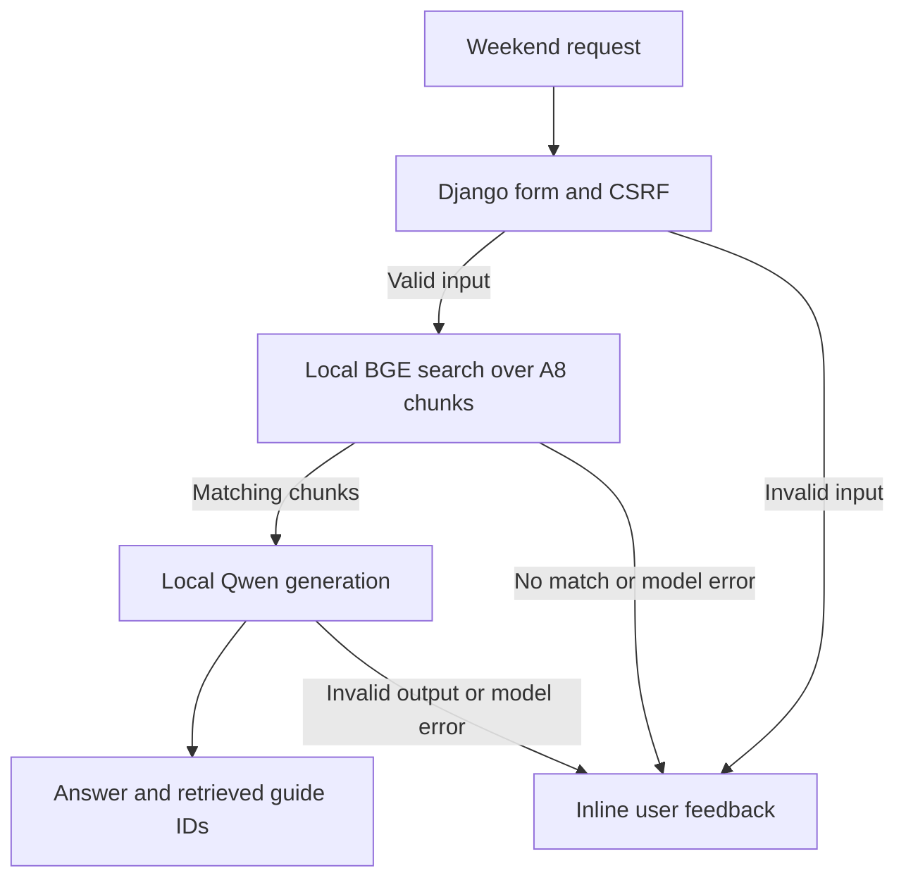

# A9 local activity suggestions

Knit's existing `/local-llm/` page answers weekend activity questions with
local recommendations grounded in the team's A8 activity guides. It is
reachable from the shared navigation. The separate `/hybrid-ai/` exercise
uses sentiment classification and optional Groq text refinement.

## Workflow and architecture



1. The existing Django view binds a CSRF-protected POST to
   `ActivityPromptForm`. The form strips surrounding whitespace and rejects
   blank requests and prompts over 2,000 characters before model work.
2. The retrieval service reads the 54 hybrid chunks already checked into
   [the A8 export](llm-test/chunks_all.csv). BGE tokenizes to at most 512 tokens,
   takes the first-token representation, and L2-normalizes each vector. The
   service applies the BGE retrieval prefix to the query and uses a cosine
   dot product over the cached vectors. Up to three chunks at or above 0.60
   enter the generation prompt. The cutoff is a heuristic tuned against the
   evaluation examples below.
3. The local llama.cpp backend uses the chat template from Qwen's official
   Q4_K_M GGUF file. It decodes greedily on CPU with a 160-token ceiling.
   Django collects streamed tokens internally, checking a 45-second soft
   deadline between chunks. Model loading and embedding are separate from
   that deadline. Each Django process accepts one recommendation at a time
   and returns a busy message for overlapping requests.
4. Django renders the escaped answer, preserving paragraph breaks, along
   with the retrieved topics and chunk IDs. The IDs identify prompt context.
   An unmatched query skips generation. A malformed result or model-loading
   failure produces user-facing feedback and logs the technical exception.

## Model selection

- **A6.** The prototype selected `Qwen/Qwen2.5-1.5B-Instruct` after
  comparing prompting styles across the team's small Qwen variant, Qwen 1.5B,
  and Gemma 2 2B. It reports stronger outputs than the small Qwen variant and
  similar quality at lower latency than Gemma. A9 retains that generator
  using its official Q4_K_M GGUF quantization. This reduces the weight size
  and can change wording and quality compared with A6.
  [A6 prototype](llm-test/ai_prototype.ipynb) ·
  [Qwen GGUF model card](https://huggingface.co/Qwen/Qwen2.5-1.5B-Instruct-GGUF)
- **A7.** The benchmark found `KingNish/Reasoning-0.5b` the best overall
  speed/quality compromise across its broader tasks. In its five generation
  runs, Qwen took 11.06–14.40 s and KingNish took 3.57–7.27 s. A9 accepts
  that latency tradeoff to retain the model selected for Knit in A6 and
  used with retrieved context in A8. A7's traffic cost estimates describe
  continuously provisioned cloud hardware. A9 runs on local CPU and uses
  zero paid inference requests.
  [A7 benchmark](llm-test/multi_model_system.ipynb)
- **A8.** The updated retrieval experiments favored mini-gte with overlapping
  passages for the tested queries and documented cross-topic mistakes with
  BGE-small. A9 chooses BGE-small and the exported sentence-based hybrid
  chunks to keep the second model small and reuse checked-in context that
  fits within a short prompt. That choice accepts a retrieval precision
  tradeoff. With 54 chunks, direct matrix scoring implements exact cosine
  ranking without a separate vector index service. The corpus has limited
  coverage of live schedules, prices, and venues.
  [A8 notebook](llm-test/rag_system.ipynb) ·
  [Experiment table](llm-test/step_2_2_evaluation_table.csv)

## Integrated evaluation

The [evaluation command](activities/management/commands/evaluate_activity_ai.py)
submits each prompt through Django's test client to the normal
`/local-llm/` POST view, including form validation and template rendering.
It prints the actual answer or error, retrieved chunk IDs, HTTP status and
elapsed time as JSON Lines. Run it from the repository root after following
the setup in [README.md](README.md).

```bash
OMP_NUM_THREADS=4 MKL_NUM_THREADS=4 python manage.py evaluate_activity_ai
```

The observed results below use real local models on an Intel Xeon Platinum
8573C CPU with four PyTorch threads and four llama.cpp decode threads.
Model files were already downloaded.
The first request includes loading both models and building the index.
Later rows reuse the initialized models. Each timing comes from a single run. The review checks whether the answer addresses the requested
activity and constraints, whether the advice is supported by retrieved
notes, and whether the output is readable and complete.

| App input | Expected behavior | Observed output and quality | Latency |
| --- | --- | --- | ---: |
| First weekend hike with roommates | Give a packing list and a beginner route criterion | Recommended water, snacks, sunscreen, a first-aid kit, a rain jacket, and a well-marked route. Useful single paragraph. The campground suggestion drifted from the day-hike question. | 30.329 s, cold |
| First week of a beginner running club with conflicting schedules | Offer a schedule and a welcoming first activity | Suggested polling members, setting a weekday and weekend run, and welcoming newcomers. Actionable single paragraph. Two of three hits were about making friends, and the answer gave limited detail on beginner pace. | 13.652 s |
| Low-stress cooking night for four friends | Propose a shared meal workflow and divide tasks | Assigned chopping and washing, and suggested a simple customizable recipe. Clear and supported. It left the other two roles and task timing unspecified. | 11.670 s |
| First book and discussion plan for a new club | Give a selection method and ways to involve everyone | Suggested matching interests and reading levels and using prepared open-ended questions. Both parts were addressed in one paragraph. The book-choice guidance was vague. | 20.833 s |
| Low-pressure ways to meet people in Champaign on Saturday | Suggest approachable group activities while avoiding live schedule claims | Offered beginner art classes and library groups as generic ideas. The paragraph led with a group for first-time mothers without any indication that it fit the user. Saturday availability remained unverified. | 11.391 s |
| ARC closing time and climbing-wall fee | Acknowledge missing live information | Returned a no-match message and skipped Qwen. The message did not invent hours or prices. | 0.044 s |
| Three rainy-day indoor ideas under $10 | Suggest affordable options or explain the coverage limit | Returned a no-match message. It avoided unsupported prices but gave the user no indoor suggestions. | 0.028 s |
| GPU purchase for model training | Reject an unrelated query | Returned a no-match message before generation. | 0.029 s |
| Whitespace-only prompt | Require a prompt | Rendered a field error. | 0.003 s |
| Prompt with 2,007 characters after stripping | Enforce the 2,000-character limit | Rendered a field error. | 0.002 s |

### Failure analysis

- **Retrieval coverage.** The rainy-day budget request is a legitimate Knit
  use case. Its highest similarity was 0.559, below the 0.60 cutoff. The
  best matches were hobby-specific chunks, and the corpus has no structured
  local pricing or indoor activity guide that could support the whole request.
- **Grounding and personalization.** The hike answer drifted into camping
  because the third retrieved chunk discussed campgrounds. The Champaign
  answer copied a niche example from a broadly relevant guide and treated it
  as a personal recommendation. Cosine similarity ranks whole excerpts,
  so it can select a relevant passage with distracting details. The
  prompt also asked for 55 words or fewer, and the tested answers exceeded
  that target even though they remained readable.
- **CPU decoding.** An initial Transformers integration with the unquantized
  Qwen checkpoint produced one answer and hit the 45-second decoding limit
  on the other four supported prompts. The initial hiking answer also added
  an unsupported four-hour estimate.

### Improvements measured

| Change | Before | After |
| --- | --- | --- |
| Decode with the official Q4_K_M GGUF and llama.cpp on CPU. Ask for shorter plain-text advice and restrict specific numbers to the request or notes. | The initial Transformers run timed out on four of five supported prompts. Running club hit the timeout at 45.186 s. The hiking answer took 52.881 s cold and included an unsupported four-hour estimate. | The final run returned an answer for all five supported prompts. Running club completed in 13.652 s, and the hike took 30.329 s cold and omitted the unsupported estimate. The backend and prompt changed together, so these timings measure the combined change. |
| Raise the similarity cutoff from 0.50 to 0.60. | The GPU question scored 0.550 against a card-collecting chunk, and the ARC hours question scored 0.546 against a sports chunk. Both would have sent irrelevant context to generation. | Both requests stopped before generation. The stricter gate also rejected the rainy-day budget request, showing the tradeoff between fewer irrelevant matches and lower coverage. |
